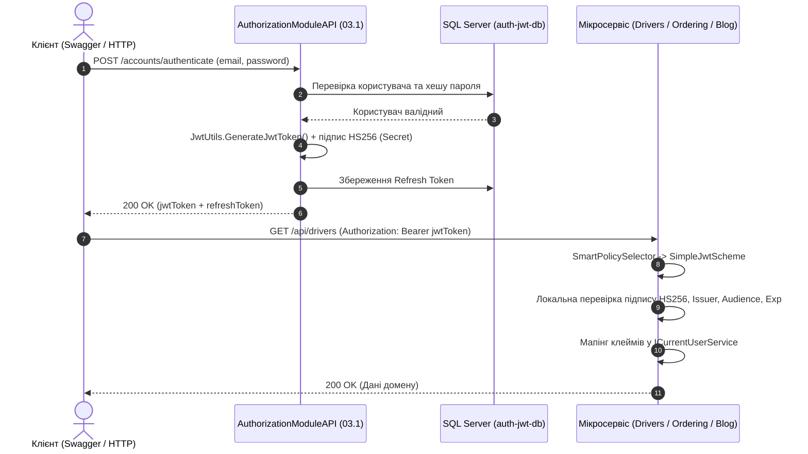

# 🔑 03.1: Простий Custom JWT (`AuthorizationModuleAPI`)

> Перший етап еволюції безпеки — власний REST-сервіс видачі та перевірки токенів на базі симетричного ключа, наслоєний на мікросервіси Craftsman.

---

## 1. Теоретичні основи

### Що таке JWT і симетричний підпис (`HMAC-SHA256`)
**JSON Web Token (JWT)** — компактний самодостатній формат передачі тверджень (`claims`) між сторонами у вигляді трьох Base64Url-блоків, розділених крапками:

`Header.Payload.Signature`

- **Header** — алгоритм підпису (`"alg": "HS256"`) та тип токена (`"typ": "JWT"`).
- **Payload** — корисне навантаження з клеймами користувача (`sub`, `email`, `exp`, `iss`, `aud`). Важливо: Payload **не зашифрований**, а лише закодований у Base64Url — його може прочитати будь-хто, хто має токен.
- **Signature** — криптографічний підпис `HMACSHA256(base64(Header) + "." + base64(Payload), Secret)`.

У підході **03.1** використовується **симетричний алгоритм (`HS256`)**: один і той самий спільний секрет (`Auth:SimpleJwt:Secret`) використовується і сервером автентифікації (`AuthorizationModuleAPI`) для створення підпису, і кожним мікросервісом для його локальної перевірки.

### Access Token та Refresh Token
- **Access Token** — короткоживучий JWT, який передається у кожному запиті (`Authorization: Bearer <token>`) і перевіряється *stateless* (без звернення до бази даних).
- **Refresh Token** — довгоживучий токен, що зберігається у базі `auth-jwt-db` (SQL Server). Дозволяє оновити Access Token без повторного введення пароля та дає можливість відкликати сесію користувача на сервері.

### Переваги та обмеження підходу 03.1
- **Переваги:** мінімальна інфраструктура, відсутність мережевих запитів до JWKS при старті сервісів, простий дебаг.
- **Обмеження:** спільний `Secret` доводиться розповсюджувати на всі мікросервіси (ризик компрометації), немає стандартного OIDC Discovery, немає вбудованого SSO та федерації з зовнішніми IdP.

---

## 2. Потік автентифікації та перевірки токена

---

## 3. Архітектурна роль та реалізація в коді

`AuthorizationModuleAPI` працює як автономний Auth-мікросервіс в Aspire (`auth-simple-api`) зі своєю ізольованою базою даних `auth-jwt-db` (SQL Server).

- **Оркестрація в Aspire:** [`AppHost.cs`](../Aspire/CargoDelivery.AppHost/AppHost.cs) (`auth-simple-api` + `auth-jwt-db`)
- **Генерація токена та клеймів:** [`JwtUtils.cs`](../AuthorizationModuleAPI/Authorization/JwtUtils.cs)
- **Схема валідації в мікросервісах:** [`01_SimpleJwtAuthExtensions.cs`](../Aspire/CargoDelivery.ServiceDefaults/Auth/01_SimpleJwtAuthExtensions.cs)
- **Автоматичний вибір схеми:** [`SmartAuthPolicyExtensions.cs`](../Aspire/CargoDelivery.ServiceDefaults/Auth/SmartAuthPolicyExtensions.cs)

### Сумісність клеймів із Craftsman (`ICurrentUserService`)
Щоб бізнес-мікросервіси (`DriversManagement`, `OrderingManagement`, `BlogManagement`) без змін працювали з токеном від `AuthorizationModuleAPI`, у `JwtUtils.GenerateJwtToken` формуються стандартні клейми:
- `sub` та `ClaimTypes.NameIdentifier` → читає `ICurrentUserService.UserId`
- `email` / `ClaimTypes.Email` → читає `ICurrentUserService.Email`
- `given_name` / `family_name` / `preferred_username` → використовуються для авто-сідінгу першого адміністратора в `UserPolicyHandler.SeedRootUser()`

---

## 4. Як продемонструвати

1. Відкрийте Swagger ресурсу `auth-simple-api` в Aspire Dashboard.
2. Зареєструйте користувача через `POST /accounts/register` та виконайте `POST /accounts/authenticate`.
3. Скопіюйте отриманий `jwtToken`.
4. Відкрийте Swagger `DriversManagement` (або скористайтесь готовим сценарієм [`03.1-SimpleJwt-Flow.http`](../Tests/HttpScenarios/03.1-SimpleJwt-Flow.http)).
5. Натисніть **Authorize** → секція **`03.1-SimpleJWT-Bearer`** → вставте токен → виконайте `GET /api/drivers`.
