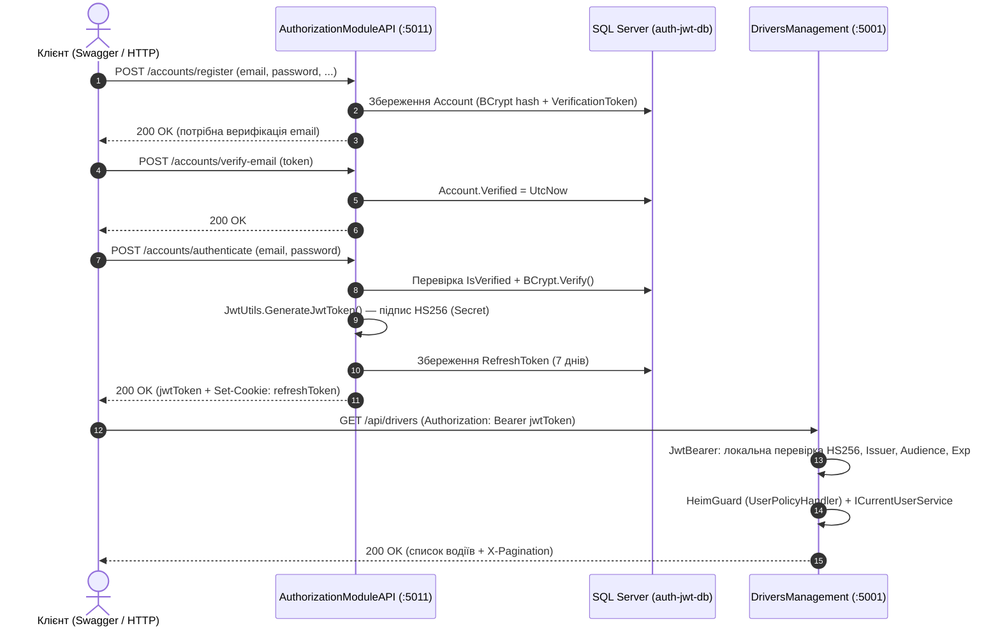

# 🔑 03.1: Простий Custom JWT (`AuthorizationModuleAPI` → `DriversManagement`)

> Перший етап еволюції безпеки — автономний REST-сервіс видачі та оновлення токенів на базі симетричного підпису **HMAC-SHA256 (`HS256`)**, підключений до мікросервісу **`DriversManagement` (`https://localhost:5001`)**.

---

## 1. Теоретичні основи

### Що таке JWT і симетричний підпис (`HS256`)
**JSON Web Token (JWT)** — компактний самодостатній формат передачі тверджень (`claims`) у вигляді трьох Base64Url-блоків, розділених крапками:

```text
Header.Payload.Signature
```

- **Header** — метадані токена: алгоритм підпису (`"alg": "HS256"`) та тип (`"typ": "JWT"`).
- **Payload** — корисне навантаження з клеймами (`sub`, `email`, `role`, `iss`, `aud`, `exp`). Payload **не зашифрований**, а лише закодований у Base64Url — прочитати його може кожен, тому паролі та секрети туди класти не можна.
- **Signature** — криптографічний підпис `HMACSHA256(base64Url(Header) + "." + base64Url(Payload), Secret)`. Гарантує цілісність токена: будь-яка зміна Payload робить підпис невалідним.

У модулі **03.1** використовується **симетричний алгоритм (`HS256`)**: один і той самий спільний секрет (`Secret`) використовується і сервером автентифікації (`AuthorizationModuleAPI`) для створення підпису, і ресурсом (`DriversManagement`) для його локальної перевірки.

### Access Token, Refresh Token та Rotation
- **Access Token** — короткоживучий JWT (**60 хвилин** у `JwtUtils.cs`), який клієнт передає у заголовку `Authorization: Bearer <token>`. Перевіряється *stateless* (без запитів до БД).
- **Refresh Token** — довгоживучий випадковий 64-байтний токен (**7 днів**), збережений у SQL Server (`auth-jwt-db`) і додатково виданий у `HttpOnly` cookie `refreshToken`.
- **Refresh Token Rotation & Reuse Detection** (реалізовано в `AccountService.RefreshToken`): при кожному оновленні старий refresh-токен відкликається й замінюється новим. Якщо хтось спробує повторно використати вже відкликаний токен (ознака крадіжки), сервер автоматично відкликає **весь ланцюжок нащадків** (`revokeDescendantRefreshTokens`).

### Коли обирати підхід 03.1, а коли — переходити далі
| Переваги | Обмеження |
| :--- | :--- |
| Мінімальна інфраструктура (не потрібен окремий OIDC/IAM сервер) | Спільний `Secret` доводиться розповсюджувати на всі сервіси-споживачі |
| Локальна перевірка підпису без мережевих запитів до JWKS | Немає стандартного OIDC Discovery (`/.well-known/openid-configuration`) |
| Повний контроль над моделлю користувача, ролями та Refresh Token | Немає вбудованого SSO, PKCE для SPA/мобільних клієнтів та зовнішньої федерації |
| Простий дебаг та швидкий старт для невеликих систем / MVP | Ротація секретного ключа потребує синхронного перезапуску всіх сервісів |

---

## 2. Потік автентифікації та валідації токена



---

## 3. Реалізація в коді

### Карта ключових файлів
- **Оркестрація в Aspire:** [`AppHost.cs`](../Aspire/CargoDelivery.AppHost/AppHost.cs) — запускає `auth-simple-api` (`:5011`) із базою `auth-jwt-db` (`WebApiJWTDatabase`) та передає `Auth__SimpleJwt__Secret`, `Auth__SimpleJwt__Issuer`, `Auth__SimpleJwt__Audience` у `driversmanagement` (`:5001`).
- **Видача та перевірка токенів:** [`JwtUtils.cs`](../AuthorizationModuleAPI/Authorization/JwtUtils.cs) — генерація Access Token (HS256, 60 хв) та криптостійкого Refresh Token (64 байти, 7 днів).
- **Бізнес-логіка акаунтів:** [`AccountService.cs`](../AuthorizationModuleAPI/Services/AccountService.cs) — `BCrypt`, ротація refresh-токенів, першому зареєстрованому користувачу автоматично призначається `Role.Admin`, наступним — `Role.User`.
- **REST-ендпоінти Auth API:** [`AccountsController.cs`](../AuthorizationModuleAPI/Controllers/AccountsController.cs).
- **Валідація токена в мікросервісі:** [`DriversManagement/Program.cs`](../DriversManagement/src/DriversManagement/Program.cs) — налаштування `AddJwtBearer`, `AddHeimGuard<UserPolicyHandler>()` та Swagger-схеми `"Bearer"`.
- **Захищений ендпоінт:** [`DriversController.cs`](../DriversManagement/src/DriversManagement/Controllers/v1/DriversController.cs) (`[Authorize]` на `GET /api/drivers`).

### Ендпоінти `AuthorizationModuleAPI` (`https://localhost:5011`)
| Метод та маршрут | Призначення |
| :--- | :--- |
| `POST /accounts/register` | Реєстрація користувача (перший користувач у БД стає `Admin`) |
| `POST /accounts/verify-email` | Підтвердження email за `VerificationToken` |
| `POST /accounts/authenticate` | Логін: повертає `jwtToken` у тілі та `refreshToken` у `HttpOnly` cookie |
| `POST /accounts/refresh-token` | Оновлення пари Access + Refresh токенів (з ротацією) |
| `POST /accounts/revoke-token` | Примусове відкликання Refresh Token (logout) |
| `POST /accounts/forgot-password` / `reset-password` | Відновлення пароля |

### Сумісність клеймів із `DriversManagement`
У `JwtUtils.GenerateJwtToken` клейми дублюються у стандартних JWT-іменах та `ClaimTypes.*`, щоб `ICurrentUserService` і `UserPolicyHandler` працювали без адаптерів:

| Клейми в токені | Куди мапляться в `DriversManagement` |
| :--- | :--- |
| `id`, `sub`, `ClaimTypes.NameIdentifier` | `ICurrentUserService.UserId` |
| `email`, `ClaimTypes.Email` | `ICurrentUserService.Email` |
| `given_name`, `family_name`, `preferred_username` | Авто-сідінг першого адміністратора (`UserPolicyHandler`) |
| `ClaimTypes.Role` (`Admin` / `User`) | Рольова авторизація |

### Конфігурація перевірки у `DriversManagement/Program.cs`
```csharp
builder.Services.AddAuthentication(JwtBearerDefaults.AuthenticationScheme)
    .AddJwtBearer(options =>
    {
        options.TokenValidationParameters = new TokenValidationParameters
        {
            ValidateIssuer = true,
            ValidIssuer = jwtIssuer,       // "AuthorizationModuleAPI"
            ValidateAudience = true,
            ValidAudience = jwtAudience,   // "cargodelivery.microservices"
            ValidateLifetime = true,
            ValidateIssuerSigningKey = true,
            IssuerSigningKey = new SymmetricSecurityKey(Encoding.ASCII.GetBytes(jwtSecret)),
            ClockSkew = TimeSpan.FromMinutes(1)
        };
    });
```

---

## 4. Покрокова демонстрація

1. **Запустіть `CargoDelivery.AppHost`** — переконайтеся в Aspire Dashboard, що `auth-simple-api` (`https://localhost:5011`) та `driversmanagement` (`https://localhost:5001`) мають статус **Running / Healthy**.
2. **Негативний кейс (401):** відкрийте Swagger `DriversManagement` (`https://localhost:5001/swagger`) і виконайте `GET /api/drivers` без токена → отримаєте **`401 Unauthorized`**.
3. **Реєстрація та верифікація в `AuthorizationModuleAPI` (`https://localhost:5011/swagger`):**
   - Виконайте `POST /accounts/register` (наприклад, `dispatcher@cargodelivery.local` / `Password123!`).
   - > **⚠️ Важливо:** `AccountService.Authenticate` перевіряє `account.IsVerified`. Після `register` візьміть `VerificationToken` з таблиці `Accounts` бази `DriversManagementJWT` (або з листа Ethereal SMTP) і викличте `POST /accounts/verify-email` із `{"token": "<VerificationToken>"}`.
4. **Отримання токена:** виконайте `POST /accounts/authenticate` → скопіюйте поле `jwtToken` із відповіді (можна вставити на [jwt.io](https://jwt.io), щоб показати `alg: HS256`, `iss`, `aud` та клейми).
5. **Позитивний кейс (200):** у Swagger `DriversManagement` натисніть **Authorize** → схема **`Bearer`** → вставте `jwtToken` (без префікса `Bearer `) → повторіть `GET /api/drivers` → **`200 OK`**.
6. **Перевірка ротації:** викличте `POST /accounts/refresh-token` у Swagger `auth-simple-api` — отримаєте новий `jwtToken`, а старий refresh-токен у БД отримає `Revoked` і `ReplacedByToken`.

---

## 5. Типові помилки та діагностика

| Симптом | Причина | Як виправити |
| :--- | :--- | :--- |
| `400 Bad Request: "Email or password is incorrect"` одразу після `register` | Акаунт ще не верифікований (`account.IsVerified == false`) | Виконайте `POST /accounts/verify-email` з токеном із БД `DriversManagementJWT` |
| `401 Unauthorized` при валідному токені | Не збігаються `Secret`, `Issuer` (`AuthorizationModuleAPI`) або `Audience` (`cargodelivery.microservices`) | Перевірте змінні `Auth__SimpleJwt__*` у `AppHost.cs` та `AppSettings` у `AuthorizationModuleAPI/appsettings.json` |
| `401 Unauthorized` з чужим токеном (від Duende / Keycloak) | Очікувана поведінка: `DriversManagement` налаштований виключно на схему `03.1` (`HS256`) | Для Duende використовуйте `BlogManagement` (`:5002`), для Keycloak — `OrderingManagement` (`:5003`) |
| `500` на `POST /accounts/register` (SMTP error) | Недоступний або прострочений тестовий акаунт `smtp.ethereal.email` | Перевірте `SmtpUser`/`SmtpPass` у `AuthorizationModuleAPI/appsettings.json` |
