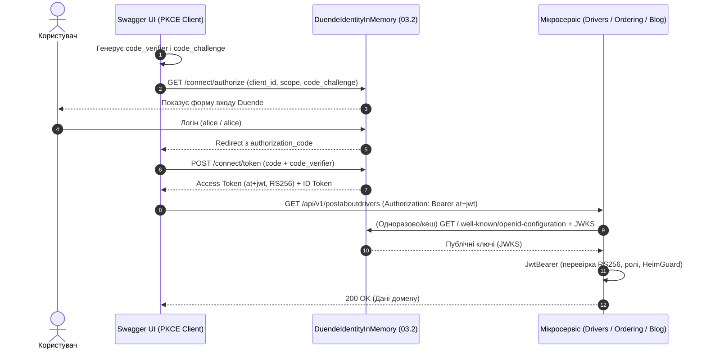

# 🏛️ 03.2: Duende IdentityServer (OAuth 2.0 / OIDC + PKCE)

> Другий етап еволюції — виділений Security Token Service (STS), побудований за стандартами OpenID Connect та OAuth 2.0.

---

## 1. Теоретичні основи

### Від Custom JWT до OAuth 2.0 та OpenID Connect (OIDC)
- **OAuth 2.0** — протокол **делегованої авторизації**: визначає, як клієнт (Swagger UI, SPA, мобільний застосунок або інший сервіс) отримує `Access Token` із чітко обмеженими правами (`Scopes`) для доступу до API.
- **OpenID Connect (OIDC)** — шар **автентифікації** поверх OAuth 2.0: додає `ID Token` (хто увійшов), стандартні ендпоінти `/userinfo` та метадані Discovery.

### Асиметричний підпис (`RS256`) та OIDC Discovery / JWKS
На відміну від `03.1`:
- Мікросервіси **не знають спільного секрету** (`Secret`). Приватний ключ для підпису зберігається виключно в `DuendeIdentityInMemory`.
- При отриманні запиту мікросервіс звертається до стандартного документа `/.well-known/openid-configuration`, знаходить адресу `jwks_uri` та завантажує **публічні ключі (JWKS)** для перевірки підпису `RS256` (та кешує їх).
- Завдяки цьому ротація ключів на сервері авторизації відбувається прозоро без оновлення конфігурацій у всіх мікросервісах.

### Основні OAuth 2.0 потоки в модулі
1. **Authorization Code Flow + PKCE** (для інтерактивних клієнтів — Swagger UI, SPA):
   - Захищає код авторизації від перехоплення за допомогою одноразового секрету `code_verifier` та його хешу `code_challenge` (без передачі `ClientSecret` у браузер).
2. **Client Credentials Flow** (для M2M — Machine-to-Machine):
   - Міжсервісна взаємодія (`m2m.client`) без участі користувача, де сервіс автентифікується власним `ClientId` + `ClientSecret`.

### ApiScopes та формат `at+jwt`
- Права доступу гранульовано через **ApiScopes**: `drivers_management`, `cargo_ordering`, `blog_management`.
- Duende випускає Access Token із заголовком `"typ": "at+jwt"` (RFC 9068). Саме за цим полем або `iss` [`SmartAuthPolicyExtensions.cs`](../Aspire/CargoDelivery.ServiceDefaults/Auth/SmartAuthPolicyExtensions.cs) відрізняє токен Duende від токенів `03.1` та `03.3`.
- Модуль `DuendeIdentityInMemory` **повністю автономний**: для роботи `03.2` він не потребує запуску Keycloak.

---

## 2. Потік Authorization Code + PKCE та валідація через JWKS

---

## 3. Реалізація в коді: де PKCE, `redirect_uri` та `/.well-known/openid-configuration`

- **Серверна частина (Duende STS, порт `5012`):**
  - Клієнт `craftsman.swagger` (`GrantTypes.Code`, `RequirePkce = true`, `RequireClientSecret = false`), `IdentityResource("roles")` та `ApiScopes` (`blog_management`): [`Config.cs`](../DuendeIdentityInMemory/Config.cs).
  - Тестові користувачі (`alice` — `SuperAdmin`/`User`, `bob` — `User`): [`TestUsers.cs`](../DuendeIdentityInMemory/TestUsers.cs).
  - Вбудовані ендпоінти `/connect/authorize`, `/connect/token` і `/.well-known/openid-configuration` підіймає `AddIdentityServer()` у [`HostingExtensions.cs`](../DuendeIdentityInMemory/HostingExtensions.cs).
- **Шляхи редиректу (`redirect_uri`):**
  - Swagger UI автоматично формує `https://localhost:<порт>/swagger/oauth2-redirect.html` (для `BlogManagement` — `https://localhost:5002/swagger/oauth2-redirect.html`).
  - Duende перевіряє їх за списком у `Config.cs`, а в `Development` додатково працює `DevLocalhostRedirectUriValidator` у `HostingExtensions.cs`, який дозволяє будь-який порт `localhost` під Aspire.
- **Клієнт і перевірка токена (`BlogManagement`, порт `5002`):**
  - `UseSwaggerUI` із `config.OAuthClientId("craftsman.swagger")` та `config.OAuthUsePkce()` вмикає генерацію `code_verifier`/`code_challenge` у браузері: [`SwaggerAppExtension.cs`](../BlogManagement/src/BlogManagement/Extensions/Application/SwaggerAppExtension.cs).
  - Налаштування `AddJwtBearer(...)`, рольових політик та Swagger `oauth2` у [`BlogManagement/Program.cs`](../BlogManagement/src/BlogManagement/Program.cs): рядок `options.Authority = duendeAuthority;` змушує `JwtBearerHandler` **автоматично (при першому запиті з токеном)** простукати `{Authority}/.well-known/openid-configuration`, забрати `jwks_uri`, закешувати публічні ключі та перевіряти підпис локально.

---

## 4. Як продемонструвати

1. Відкрийте Swagger `BlogManagement` (`https://localhost:5002/swagger`).
2. Натисніть **Authorize** (`craftsman.swagger`, `client_secret` порожній).
3. Оберіть скоупи (`openid`, `profile`, `roles`, `blog_management`) та натисніть **Authorize**.
4. Браузер перенаправить на сторінку входу Duende (`https://localhost:5012`). Увійдіть як **`alice`** / **`alice`** (або `bob` / `bob`).
5. Після редиректу назад у Swagger виконайте захищений запит у `BlogManagement`.
6. Готовий HTTP-сценарій для **Client Credentials** (`m2m.client`) також доступний у [`03.2-Duende-OIDC-Flow.http`](../Tests/HttpScenarios/03.2-Duende-OIDC-Flow.http).
