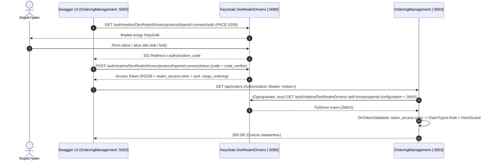

# 🏢 03.3: Keycloak Enterprise IAM + Pulumi IaC (`OrderingManagement`)

> Третій етап еволюції безпеки — повноцінний корпоративний сервер ідентифікації та доступу **Keycloak 26** у Docker-контейнері під керуванням **.NET Aspire**, декларативний **Infrastructure as Code (IaC)** на **Pulumi (`KeycloakPulumiAuth`)**, мапінг вкладених ролей `realm_access.roles` у **`OrderingManagement` (`https://localhost:5003`)** та наскрізне прокидання токена через `ApiGateway` / `HttpAggregator`.

---

## 1. Теоретичні основи

### Навіщо Enterprise IAM (Keycloak) після STS у пам'яті (`03.2`)
`DuendeIdentityInMemory` чудово підходить для кастомного .NET STS, але в реальних корпоративних системах зазвичай потрібна готова IAM-платформа з адмін-панеллю та персистентним сховищем:
- **Realm (`DevRealmDrivers`)** — ізольований простір користувачів, клієнтів, ролей, скоупів і політик безпеки (multi-tenancy).
- **Готові Enterprise-можливості:** 2FA/MFA (TOTP/WebAuthn), політики паролів і блокування при brute-force, керування активними сесіями в UI, інтеграція з корпоративним **LDAP / Active Directory**, соціальний логін та аудит подій входу.
- **Персистентна БД:** Keycloak зберігає всі налаштування в окремому контейнері PostgreSQL (`keycloak-pg` з volume `keycloak-pg-data`).

### Infrastructure as Code (IaC) для безпеки: `realm-export.json` vs Pulumi
Ручне клацання клієнтів і ролей в адмін-панелі не відтворюється між `dev` → `stage` → `prod`. У проєкті реалізовано **обидва підходи**:

| Критерій | Кейс A: `realm-export.json` | Кейс B: Pulumi IaC (`KeycloakPulumiAuth`) |
| :--- | :--- | :--- |
| **Назва реалму** | `DevRealmDrivers` | `DevRealmDrivers-Pulumi` |
| **Як застосовується** | Прапорець `--import-realm` при старті контейнера Aspire | `pulumi up` через Keycloak Admin REST API |
| **Оновлення існуючого реалму** | Імпортується лише якщо реалму ще немає в БД | Точковий `diff` (`pulumi preview` / `pulumi up`) **без перезапуску** контейнера і без втрати юзерів |
| **Де зручно** | Швидкий локальний старт «з коробки» | CI/CD, GitOps, версіонування змін безпеки на C# |

### Мапінг ролей Keycloak (`realm_access.roles` → `ClaimTypes.Role`)
На відміну від Duende (`"role": ["SuperAdmin"]`), Keycloak поміщає ролі реалму у вкладений JSON-об'єкт усередині Access Token:

```json
"realm_access": {
  "roles": ["SuperAdmin", "User"]
}
```

ASP.NET Core за замовчуванням не розбирає вкладений JSON, тому `User.IsInRole("SuperAdmin")` і `policy.RequireRole("SuperAdmin")` не спрацюють. У [`OrderingManagement/Program.cs`](../OrderingManagement/src/OrderingManagement/Program.cs) подія `JwtBearerEvents.OnTokenValidated` парсить `realm_access.roles` і додає кожну роль як стандартний `ClaimTypes.Role`.

### Наскрізне прокидання токена (Token Propagation)
У розподіленому запиті:
`Client → CargoDelivery.ApiGateway (Ocelot :5000) → CargoDelivery.HttpAggregator (:5005) → OrderingManagement (:5003)`

[`AuthorizationForwardingHandler`](../Aspire/CargoDelivery.ServiceDefaults/Auth/AuthorizationForwardingHandler.cs), підключений до всіх типізованих `HttpClient` в [`HttpAggregator/Program.cs`](../CargoDelivery.HttpAggregator/Program.cs), автоматично копіює заголовок `Authorization: Bearer ...` із вхідного `HttpContext` у вихідні запити до мікросервісів.

> **Архітектурна нотатка про федерацію:** за потреби Keycloak також можна підключити як зовнішній Identity Provider (OIDC Broker) до Duende (`03.2`), але в поточному стенді `03.2` і `03.3` навмисно працюють **незалежно**, щоб їх можна було демонструвати окремо.

---

## 2. Потік автентифікації Keycloak → `OrderingManagement`



---

## 3. Реалізація в коді

- **Оркестрація контейнера в Aspire:** [`AppHost.cs`](../Aspire/CargoDelivery.AppHost/AppHost.cs):
  - `keycloak-pg` (PostgreSQL з data volume `keycloak-pg-data`);
  - `keycloak` (`quay.io/keycloak/keycloak:26.0`, порт `5080`, `KC_HTTP_RELATIVE_PATH=/auth`, `--import-realm`, адмін `admin`/`admin`);
  - передача `Auth__Keycloak__Authority` (`http://localhost:5080/auth/realms/DevRealmDrivers`) в `orderingmanagement`.
- **Автоімпорт реалму (Кейс A):** [`realm-export.json`](../Keycloak/realm-export.json):
  - реалм `DevRealmDrivers`, ролі `SuperAdmin` і `User`;
  - клієнт `drivers_management.swagger` (Public + PKCE `S256` + `directAccessGrantsEnabled: true` для HTTP-тестів);
  - протокольні мапери: `oidc-usermodel-realm-role-mapper` (`realm_access.roles`) та `oidc-audience-mapper` (`cargo_ordering`, `drivers_management`, `blog_management`);
  - користувачі `alice`/`alice` (`SuperAdmin`, `User`) та `bob`/`bob` (`User`) із `temporary: false`.
- **Pulumi IaC (Кейс B):** [`RealmBuild.cs`](../KeycloakPulumiAuth/RealmBuild.cs) + [`Pulumi.dev.yaml`](../KeycloakPulumiAuth/Pulumi.dev.yaml) (`keycloak:url: http://localhost:5080/auth`).
- **Валідація та мапінг ролей:** [`OrderingManagement/Program.cs`](../OrderingManagement/src/OrderingManagement/Program.cs) + [`SwaggerAppExtension.cs`](../OrderingManagement/src/OrderingManagement/Extensions/Application/SwaggerAppExtension.cs) (`OAuthClientId("drivers_management.swagger")`, `OAuthUsePkce()`).
- **Захищений ендпоінт:** [`OrdersController.cs`](../OrderingManagement/src/OrderingManagement/Controllers/v1/OrdersController.cs) (`[Authorize]` на `GET /api/orders`).
- **Прокидання токена:** [`AuthorizationForwardingHandler.cs`](../Aspire/CargoDelivery.ServiceDefaults/Auth/AuthorizationForwardingHandler.cs) → підключено в [`HttpAggregator/Program.cs`](../CargoDelivery.HttpAggregator/Program.cs).

---

## 4. Два практичні кейси демонстрації

### Кейс A: Keycloak «з коробки» в Aspire (`DevRealmDrivers`)
1. Запустіть `CargoDelivery.AppHost` (`F5`) — Aspire підійме `keycloak-pg` і `keycloak` (`http://localhost:5080/auth`) та імпортує `DevRealmDrivers`.
2. **Негативний кейс (401):** відкрийте Swagger `OrderingManagement` (`https://localhost:5003/swagger`) і викличте `GET /api/orders` без токена → **`401 Unauthorized`**.
3. **Вхід через PKCE:** натисніть **Authorize** (`drivers_management.swagger`, `client_secret` порожній) → виберіть скоупи `openid`, `profile`, `roles`, `cargo_ordering` → **Authorize**.
4. На екрані Keycloak увійдіть як **`alice` / `alice`** (`SuperAdmin`, `User`) або **`bob` / `bob`** (`User`).
5. **Позитивний кейс (200):** повторіть `GET /api/orders` → **`200 OK`**.
6. **Альтернатива через HTTP (Direct Access Grant для швидкого тесту):**
   ```http
   POST http://localhost:5080/auth/realms/DevRealmDrivers/protocol/openid-connect/token
   Content-Type: application/x-www-form-urlencoded

   grant_type=password&client_id=drivers_management.swagger&username=alice&password=alice&scope=openid profile roles cargo_ordering
   ```
   Отриманий `access_token` передайте у `GET https://localhost:5003/api/orders` із заголовком `Authorization: Bearer <token>`.

### Кейс B: Keycloak + Pulumi IaC + сценарій Update (`DevRealmDrivers-Pulumi`)
1. Переконайтеся, що контейнер Keycloak з Aspire запущений (`http://localhost:5080/auth`, адмінка: `admin` / `admin`).
2. У папці `02-Microservices-Craftsman\KeycloakPulumiAuth` виконайте первинне розгортання:
   ```powershell
   pulumi login --local
   pulumi stack select dev
   pulumi up
   ```
   В адмінці Keycloak поруч із `DevRealmDrivers` з'явиться новий реалм **`DevRealmDrivers-Pulumi`** із клієнтами, скоупами та користувачами `alice`/`bob`.
   > **ℹ️ Примітка:** у `RealmBuild.cs` для `alice`/`bob` задано `Temporary = true`, тому при першому інтерактивному вході саме в `DevRealmDrivers-Pulumi` Keycloak попросить задати постійний пароль.
3. **Демонстрація Update без простою:** у [`RealmBuild.cs`](../KeycloakPulumiAuth/RealmBuild.cs) розкоментуйте блок `6. КЕЙС АПДЕЙТА (UPDATE)` (новий скоуп `cargo_analytics`, M2M-клієнт `ordering_management.analytics` і роль `Dispatcher`) та виконайте:
   ```powershell
   pulumi preview   # покаже точковий diff: + create лише для 3 нових ресурсів
   pulumi up        # оновить живий Keycloak без перезапуску контейнера
   ```

---

## 5. Типові помилки та діагностика

| Симптом | Причина | Як виправити |
| :--- | :--- | :--- |
| Зміни в `realm-export.json` не застосувалися після перезапуску | Keycloak із `--import-realm` пропускає імпорт, якщо реалм `DevRealmDrivers` уже є в PostgreSQL volume `keycloak-pg-data` | Видаліть реалм в адмінці Keycloak або очистьте Docker volume `keycloak-pg-data` та перезапустіть AppHost |
| `404` на `/.well-known/openid-configuration` | Забуто префікс `/auth` (`KC_HTTP_RELATIVE_PATH=/auth`) | Правильний URL: `http://localhost:5080/auth/realms/DevRealmDrivers/.well-known/openid-configuration` |
| `User.IsInRole("SuperAdmin")` повертає `false` (`403`) | Не спрацював мапінг `realm_access.roles` або не вибрано скоуп `roles` | Перевірте наявність блоку `OnTokenValidated` в `OrderingManagement/Program.cs` і скоуп `roles` при логіні |
| `IDX20803` / помилка HTTPS Metadata у `OrderingManagement` | Keycloak у локальному Docker працює по `http://` | Переконайтеся, що `ASPNETCORE_ENVIRONMENT=Development` (`options.RequireHttpsMetadata = !builder.Environment.IsDevelopment()`) |
| `pulumi up` не може підключитись до Keycloak | Контейнер `keycloak` ще не стартував або порт `5080` зайнятий | Дочекайтеся готовності `http://localhost:5080/auth` та перевірте `Pulumi.dev.yaml` |
