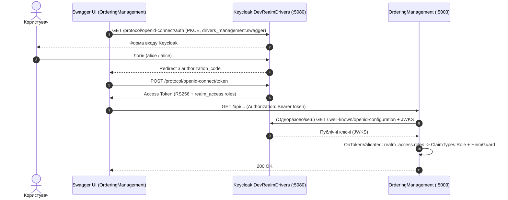

# 🏢 03.3: Keycloak Enterprise IAM + Pulumi IaC (`OrderingManagement`)

> Третій етап — повноцінний корпоративний сервер ідентифікації та доступу **Keycloak** у Docker під керуванням Aspire, декларативний IaC на **Pulumi** (`KeycloakPulumiAuth`) та перевірка токенів з мапінгом ролей у `OrderingManagement`.

---

## 1. Теоретичні основи

### Що таке Enterprise IAM і навіщо потрібен Keycloak
На відміну від мінімального STS у пам'яті (`03.2`), **Keycloak** — це готовий сервер керування ідентифікацією та доступом (IAM):
- **Realm (`DevRealmDrivers`)** — ізольований простір користувачів, клієнтів, ролей і політик безпеки.
- **Вбудовані можливості Enterprise-рівня:** 2FA/MFA, політики складності та ротації паролів, керування активними сесіями в адмін-панелі, інтеграція з корпоративним LDAP / Active Directory, аудит подій входу.
- **Власна персистентна БД:** Keycloak зберігає стан у окремому PostgreSQL-контейнері (`keycloak-pg`).

### Infrastructure as Code (IaC) для безпеки: Pulumi vs `realm-export.json`
Налаштування реалмів, клієнтів та секретів вручну через адмін-панель не відтворюється між середовищами (`dev` → `stage` → `prod`). У проєкті показано два способи автоматизації:
1. **Автоімпорт при локальному старті Aspire:** контейнер `keycloak` підіймається з `--import-realm` із файла [`realm-export.json`](../Keycloak/realm-export.json).
2. **Декларативний IaC через Pulumi:** проєкт [`KeycloakPulumiAuth`](../KeycloakPulumiAuth/RealmBuild.cs) описує Realm, OpenID Clients, скоупи, Audience Mappers та тестових користувачів на C# як код, який можна версіонувати в Git і накочувати через `pulumi up`.

### Мапінг ролей Keycloak (`realm_access.roles` → `ClaimTypes.Role`)
Keycloak кладе ролі реалму всередину вкладеного JSON-клейму `realm_access: { "roles": ["SuperAdmin", "User"] }`. У [`OrderingManagement/Program.cs`](../OrderingManagement/src/OrderingManagement/Program.cs) подією `JwtBearerEvents.OnTokenValidated` ці ролі розбираються і додаються як стандартні `ClaimTypes.Role`, щоб працювали політики `RequireRole(...)` та `HeimGuard`.

### Наскрізне прокидання токена (Token Propagation)
У мікросервісній архітектурі запит проходить ланцюжок:
`Client → CargoDelivery.ApiGateway (Ocelot) → CargoDelivery.HttpAggregator → OrderingManagement`.

Щоб кінцевий мікросервіс знав, **який саме користувач** ініціював запит, [`AuthorizationForwardingHandler`](../Aspire/CargoDelivery.ServiceDefaults/Auth/AuthorizationForwardingHandler.cs) у `HttpAggregator` автоматично копіює заголовок `Authorization: Bearer ...` у всі вихідні HTTP-виклики.

---

## 2. Діаграма потоку Keycloak → `OrderingManagement`



---

## 3. Реалізація в коді

- **Контейнер Keycloak + PostgreSQL в Aspire:** [`AppHost.cs`](../Aspire/CargoDelivery.AppHost/AppHost.cs) (`keycloak-pg`, `keycloak :5080`)
- **Автоімпорт реалму:** [`realm-export.json`](../Keycloak/realm-export.json)
- **Pulumi IaC конфігурація:** [`RealmBuild.cs`](../KeycloakPulumiAuth/RealmBuild.cs)
- **Валідація токена, мапінг ролей і Swagger PKCE:** [`OrderingManagement/Program.cs`](../OrderingManagement/src/OrderingManagement/Program.cs) та [`SwaggerAppExtension.cs`](../OrderingManagement/src/OrderingManagement/Extensions/Application/SwaggerAppExtension.cs)
- **Прокидання Bearer-токена в агрегаторі:** [`AuthorizationForwardingHandler.cs`](../Aspire/CargoDelivery.ServiceDefaults/Auth/AuthorizationForwardingHandler.cs)

---

## 4. Два практичні кейси демонстрації

### Кейс A: Keycloak «з коробки» для Aspire (автоімпорт `realm-export.json`)
1. Запустіть `CargoDelivery.AppHost` (`F5`) — Aspire сам підійме `keycloak` (`:5080`) + `keycloak-pg` та імпортує **`DevRealmDrivers`**.
2. Відкрийте Swagger `OrderingManagement` (`https://localhost:5003/swagger`).
3. Натисніть **Authorize** (`drivers_management.swagger`, `client_secret` порожній) і оберіть скоупи (`openid`, `profile`, `roles`, `cargo_ordering`).
4. Увійдіть у Keycloak як **`alice`** / **`alice`** (`SuperAdmin`, `User`) або **`bob`** / **`bob`** (`User`).
5. Виконайте захищений запит у `OrderingManagement` або запустіть HTTP-запити з [`03.3-Keycloak-Federation.http`](../Tests/HttpScenarios/03.3-Keycloak-Federation.http).

### Кейс B: Keycloak + Pulumi IaC + сценарій Update (`DevRealmDrivers-Pulumi`)
1. Переконайтеся, що контейнер Keycloak з Aspire вже запущений на `http://localhost:5080/auth` (перевірено у [`Pulumi.dev.yaml`](../KeycloakPulumiAuth/Pulumi.dev.yaml)).
2. У папці `02-Microservices-Craftsman\KeycloakPulumiAuth` виконайте первинне розгортання:
   ```powershell
   pulumi login --local
   pulumi stack select dev
   pulumi up
   ```
   У адмінці Keycloak (`http://localhost:5080/auth`, `admin`/`admin`) поруч із `DevRealmDrivers` з'явиться новий реалм **`DevRealmDrivers-Pulumi`**.
3. **Демонстрація Update:** у [`RealmBuild.cs`](../KeycloakPulumiAuth/RealmBuild.cs) розкоментуйте блок `6. КЕЙС АПДЕЙТА (UPDATE)` (новий скоуп `cargo_analytics`, M2M-клієнт `ordering_management.analytics` і роль `Dispatcher`) та виконайте:
   ```powershell
   pulumi preview   # покаже + create лише для 3 нових ресурсів
   pulumi up        # точково оновить живий Keycloak без перезапуску контейнера
   ```
