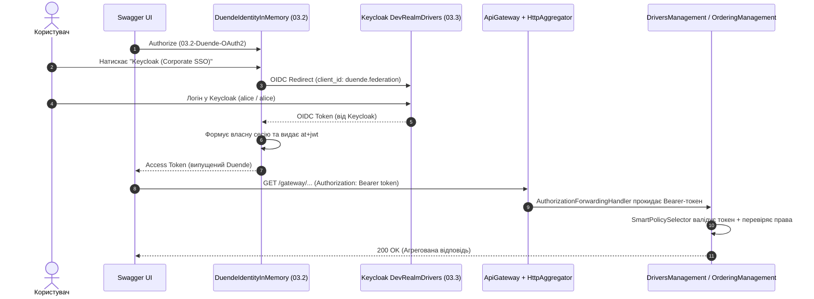

# 🏢 03.3: Keycloak + Pulumi IaC та Федерація з Duende

> Третій етап — корпоративний Identity & Access Management (Keycloak у Docker під Aspire), декларативний IaC на Pulumi та опціональна OIDC-федерація з Duende IdentityServer.

---

## 1. Теоретичні основи

### Що таке Enterprise IAM і навіщо потрібен Keycloak
На відміну від мінімального STS у пам'яті (`03.2`), **Keycloak** — це повноцінний готовий сервер керування ідентифікацією та доступом (IAM):
- **Realm (`DevRealmDrivers`)** — ізольований простір користувачів, клієнтів, ролей і політик безпеки.
- **Вбудовані можливості Enterprise-рівня:** 2FA/MFA, політики складності та ротації паролів, керування активними сесіями в UI, інтеграція з корпоративним LDAP / Active Directory, аудит подій входу.
- **Власна персистентна БД:** Keycloak зберігає стан у окремому PostgreSQL-контейнері (`keycloak-pg`).

### Infrastructure as Code (IaC) для безпеки: Pulumi vs `realm-export.json`
Налаштування реалмів, клієнтів та секретів вручну через адмін-панель не відтворюється між середовищами (`dev` → `stage` → `prod`). У проєкті показано два способи автоматизації:
1. **Автоімпорт при локальному старті Aspire:** контейнер `keycloak` підіймається з `--import-realm` із файла [`realm-export.json`](../Keycloak/realm-export.json).
2. **Декларативний IaC через Pulumi:** проєкт [`KeycloakPulumiAuth`](../KeycloakPulumiAuth/RealmBuild.cs) описує Realm, OpenID Clients, ролі та тестових користувачів на C# як код, який можна версіонувати в Git і накочувати через `pulumi up`.

### Патерн Identity Brokering / Federation (Keycloak → Duende)
У великих системах часто розділяють:
- **Внутрішній STS (`Duende`)** — видає токени зі стабільним контрактом і бізнес-клеймами для власних мікросервісів.
- **Зовнішній корпоративний IdP (`Keycloak`)** — відповідає за фактичну автентифікацію користувачів (логін, 2FA, корпоративний SSO).

Це дозволяє підключати або змінювати зовнішніх провайдерів (Keycloak, Entra ID, Google) без переписування мікросервісів. У нашому коді `DuendeIdentityInMemory` лишається автономним і підключає Keycloak **лише опціонально**, коли з Aspire передано `Keycloak:Authority`.

### Наскрізне прокидання токена (Token Propagation)
У мікросервісній архітектурі запит проходить ланцюжок:
`Client → CargoDelivery.ApiGateway (Ocelot) → CargoDelivery.HttpAggregator → DriversManagement / OrderingManagement / BlogManagement`.

Щоб кінцеві мікросервіси знали, **який саме користувач** ініціював запит, [`AuthorizationForwardingHandler`](../Aspire/CargoDelivery.ServiceDefaults/Auth/CargoAuthServiceExtensions.cs) у `HttpAggregator` автоматично копіює заголовок `Authorization: Bearer ...` із вхідного `HttpContext` у всі вихідні HTTP-виклики.

---

## 2. Діаграма федерації (Keycloak → Duende) та Token Propagation

---

## 3. Реалізація в коді

- **Контейнер Keycloak + PostgreSQL в Aspire:** [`AppHost.cs`](../Aspire/CargoDelivery.AppHost/AppHost.cs) (`keycloak-pg`, `keycloak`, `Keycloak__Authority`)
- **Автоімпорт реалму:** [`realm-export.json`](../Keycloak/realm-export.json)
- **Pulumi IaC конфігурація:** [`RealmBuild.cs`](../KeycloakPulumiAuth/RealmBuild.cs)
- **Опціональна федерація в Duende:** [`HostingExtensions.cs`](../DuendeIdentityInMemory/HostingExtensions.cs)
- **Пряма валідація токенів Keycloak у мікросервісах:** [`03_KeycloakAuthExtensions.cs`](../Aspire/CargoDelivery.ServiceDefaults/Auth/03_KeycloakAuthExtensions.cs)
- **Прокидання Bearer-токена в агрегаторі:** `AuthorizationForwardingHandler` у [`CargoAuthServiceExtensions.cs`](../Aspire/CargoDelivery.ServiceDefaults/Auth/CargoAuthServiceExtensions.cs)

---

## 4. Як продемонструвати

1. **Варіант A (Федерація через Duende):** у Swagger `DriversManagement` оберіть **`03.2-Duende-OAuth2`** → на сторінці Duende натисніть кнопку **`Keycloak (Corporate SSO)`** → увійдіть у Keycloak як `alice` / `alice`.
2. **Варіант B (Прямий вхід у Keycloak):** у Swagger оберіть **`03.3-Keycloak-OAuth2`** або запустіть HTTP-запити з [`03.3-Keycloak-Federation.http`](../Tests/HttpScenarios/03.3-Keycloak-Federation.http).
3. У **Aspire Dashboard → Traces** покажіть єдиний розподілений трейс проходження токена через `ApiGateway` → `HttpAggregator` → `DriversManagement` + `OrderingManagement`.
