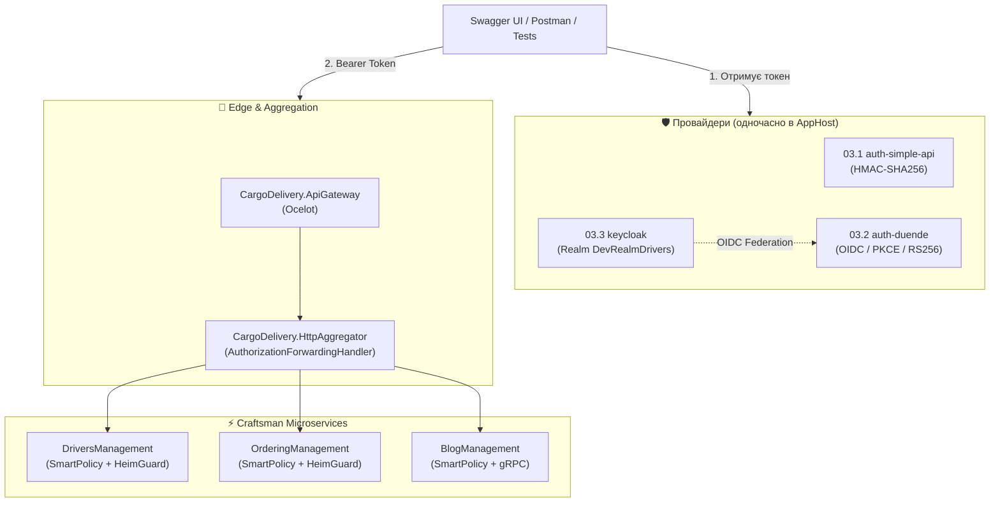

# 🛡️ 02-03-Identity-Security-Documentation: Багатошарова Безпека в .NET 10 Aspire

> Документаційний модуль Блоку 2 (`02-Microservices-Craftsman`), присвячений наслоєнню підсистеми безпеки (`03-Identity-Security`) поверх розподілених мікросервісів під керуванням **.NET 10 Aspire**.

---

## 🗺️ Навігація по розділах (03.1 → 03.2 → 03.3)

| № | Посібник | Провайдер | Ключова тема |
| :---: | :--- | :--- | :--- |
| **03.1** | [03.1_Simple_JWT_AuthorizationModuleAPI.md](03.1_Simple_JWT_AuthorizationModuleAPI.md) | `AuthorizationModuleAPI` | Класичний Custom JWT (HMAC-SHA256), власна БД користувачів та інтеграція з `HeimGuard` |
| **03.2** | [03.2_Duende_IdentityServer_OIDC.md](03.2_Duende_IdentityServer_OIDC.md) | `DuendeIdentityInMemory` | Виділений STS (OAuth 2.0 / OIDC), Discovery, Authorization Code + PKCE, `at+jwt` та Scopes |
| **03.3** | [03.3_Keycloak_Pulumi_And_Duende_Federation.md](03.3_Keycloak_Pulumi_And_Duende_Federation.md) | `Keycloak` + `KeycloakPulumiAuth` + `Duende` | Enterprise IAM у контейнері Aspire, IaC на Pulumi, OIDC-федерація у Duende та проброс токенів |

---

## 🏗️ Єдина архітектура під керуванням `CargoDelivery.AppHost`

Усі три провайдери запускаються **одночасно** у [`AppHost.cs`](../Aspire/CargoDelivery.AppHost/AppHost.cs), а мікросервіси (`DriversManagement`, `OrderingManagement`, `BlogManagement`) приймають токени від будь-якого з них через [`SmartAuthPolicyExtensions.cs`](../Aspire/CargoDelivery.ServiceDefaults/Auth/SmartAuthPolicyExtensions.cs):

---

## 📊 Порівняльна таблиця трьох підходів

| Критерій | 03.1 Simple JWT | 03.2 Duende IdentityServer | 03.3 Keycloak + Duende |
| :--- | :--- | :--- | :--- |
| **Схема в коді** | `SimpleJwtScheme` | `DuendeScheme` | `KeycloakScheme` / `DuendeScheme` |
| **Підпис токена** | Симетричний (`HMAC-SHA256`) | Асиметричний (`RS256` / JWKS) | Асиметричний (`RS256` / JWKS) |
| **Де лежать паролі** | У БД самого сервісу (`AuthorizationModuleAPI`) | У STS (`DuendeIdentityInMemory`) | У корпоративному IAM (`Keycloak`) |
| **SSO / Федерація** | Немає | Так (OIDC) | Так (Enterprise SSO + LDAP/2FA + Pulumi IaC) |
| **Swagger авторизація** | `03.1-SimpleJWT-Bearer` | `03.2-Duende-OAuth2` | `03.3-Keycloak-OAuth2` або через кнопку в Duende |
