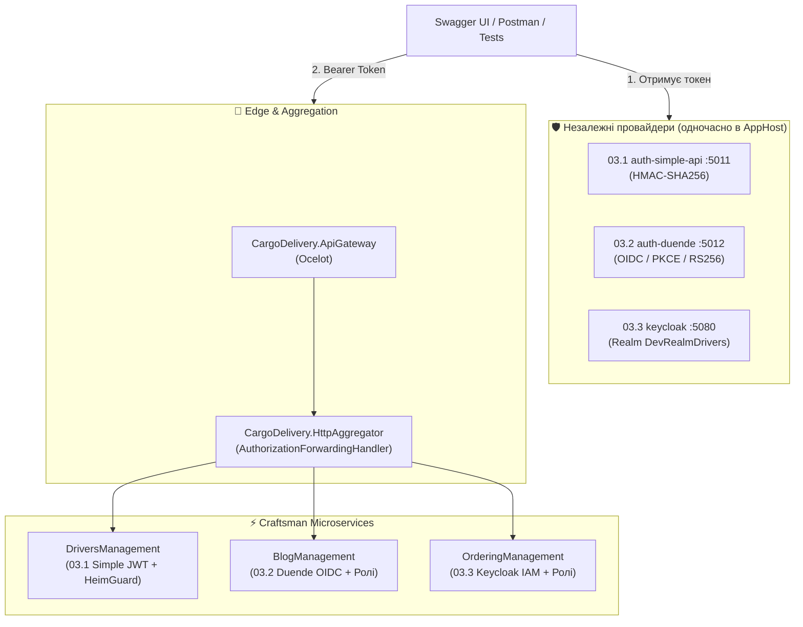

# 🛡️ 02-03-Identity-Security-Documentation: Багатошарова Безпека в .NET 10 Aspire

> Документаційний модуль Блоку 2 (`02-Microservices-Craftsman`), присвячений наслоєнню підсистеми безпеки (`03-Identity-Security`) поверх розподілених мікросервісів під керуванням **.NET 10 Aspire**.

---

## 🗺️ Навігація по розділах (03.1 → 03.2 → 03.3)

| № | Посібник | Провайдер | Ключова тема |
| :---: | :--- | :--- | :--- |
| **03.1** | [03.1_Simple_JWT_AuthorizationModuleAPI.md](03.1_Simple_JWT_AuthorizationModuleAPI.md) | `AuthorizationModuleAPI` | Класичний Custom JWT (HMAC-SHA256), власна БД користувачів та інтеграція з `HeimGuard` |
| **03.2** | [03.2_Duende_IdentityServer_OIDC.md](03.2_Duende_IdentityServer_OIDC.md) | `DuendeIdentityInMemory` | Виділений STS (OAuth 2.0 / OIDC), Discovery, Authorization Code + PKCE, `at+jwt` та Scopes |
| **03.3** | [03.3_Keycloak_Pulumi_And_Duende_Federation.md](03.3_Keycloak_Pulumi_And_Duende_Federation.md) | `Keycloak` + `KeycloakPulumiAuth` | Enterprise IAM у контейнері Aspire, IaC на Pulumi, мапінг `realm_access.roles` та проброс токенів |

---

## 🏗️ Єдина архітектура під керуванням `CargoDelivery.AppHost`

Усі три провайдери запускаються **незалежно й одночасно** у [`AppHost.cs`](../Aspire/CargoDelivery.AppHost/AppHost.cs), а кожен бізнес-мікросервіс демонструє свій окремий підхід прямо у своєму `Program.cs`:

---

## 🌐 Карта портів платформи

| Група | Сервіс | Порт | Призначення |
| :--- | :--- | :--- | :--- |
| **Gateway / BFF** | `CargoDelivery.ApiGateway` | `https://localhost:5000` | Ocelot API Gateway |
| | `CargoDelivery.HttpAggregator` | `https://localhost:5005` | HTTP Aggregator (Scatter-Gather) |
| **Мікросервіси** | `DriversManagement` (03.1) | `https://localhost:5001` | Водії (Simple JWT) |
| | `BlogManagement` (03.2) | `https://localhost:5002` | Блог (Duende OIDC + ролі) |
| | `OrderingManagement` (03.3) | `https://localhost:5003` | Замовлення (Keycloak IAM) |
| **Auth-провайдери** | `AuthorizationModuleAPI` (03.1) | `https://localhost:5011` (`http://localhost:5111`) | Custom JWT API |
| | `DuendeIdentityInMemory` (03.2) | `https://localhost:5012` | Duende IdentityServer |
| | `Keycloak` (03.3 контейнер) | `http://localhost:5080` | Keycloak (`DevRealmDrivers`) |

---

## 📊 Порівняльна таблиця трьох підходів

| Критерій | 03.1 Simple JWT | 03.2 Duende IdentityServer | 03.3 Keycloak + Duende |
| :--- | :--- | :--- | :--- |
| **Мікросервіс** | `DriversManagement` | `BlogManagement` | `OrderingManagement` |
| **Підпис токена** | Симетричний (`HMAC-SHA256`) | Асиметричний (`RS256` / JWKS) | Асиметричний (`RS256` / JWKS) |
| **Де лежать паролі** | У БД самого сервісу (`AuthorizationModuleAPI`) | У STS (`DuendeIdentityInMemory`) | У корпоративному IAM (`Keycloak`) |
| **SSO / Федерація** | Немає | Так (OIDC + ролі) | Так (Enterprise SSO + `realm_access.roles` + Pulumi IaC) |
| **Swagger авторизація** | Bearer JWT | OAuth2 PKCE (Duende) | OAuth2 PKCE (Keycloak) |
